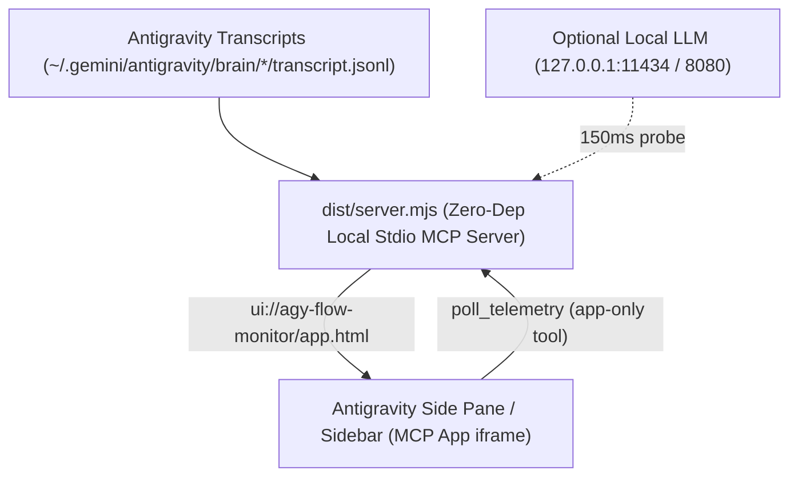

<div align="center">

# AGY Flow Monitor

**Zero-dependency real-time execution flow & telemetry side-pane dashboard for Google Antigravity**

[](./README.md)
[](./README.ja.md)
[](./README.zh-CN.md)

[](./LICENSE)
[](https://nodejs.org/)
[](#installation)
[](#security--privacy)

</div>

---

## Overview

**AGY Flow Monitor** is a self-contained **MCP App** plugin that embeds a live, terminal-inspired architecture & telemetry dashboard directly inside the **Google Antigravity** side pane (and full-page sidebar view).

It reads your local Antigravity session transcripts (`transcript.jsonl`) in real time and visualizes how your agent executes tools, spawns parallel subagents, routes MCP calls, and consumes context — with **zero runtime dependencies**, **zero external telemetry**, and **no `npm install` required**.

---

## Key Features

- **Real-Time Metrics Strip**
  - **Context Window Gauge**: Model-aware limit detection (`1M` for Gemini, `200K` for Claude, `128K` for GPT-4o) with color-coded usage bar
  - **Cache Hit Rate**: Live prompt cache efficiency (`cache_read_tokens / active_context`)
  - **Output Speed & Step Latency**: Estimated tokens/sec and tool/turn latency
- **Animated Execution Flow Diagram**
  - **Main Agent Node**: Active model, status (`ready` / `executing` / `swarming`), latest tool, cumulative tokens
  - **Adaptive MCP Router**: Automatically tracks your top active MCP servers (and switches to confidence-meter mode when `typesafe-ai` / JEV is detected)
  - **3-Slot Parallel Fan-Out**: Automatically switches between **Subagent Swarm** (`browser`, `research`, etc.) and **Parallel Tool Execution** (`search_web`, `read_file`, `run_command`, etc.) with live progress bars and glowing SVG data packets
  - **Collapsible Side Rail (`RAIL` button)**: Displays Advisor/Audit MCP activity and Local LLM status (Ollama `127.0.0.1:11434` / llama.cpp `127.0.0.1:8080`), or collapses cleanly for standard single-model workflows
- **Activity Timeline & Live Session Log**
  - 28-step color-coded sparkline showing layer rhythm at a glance
  - Auto-scrolling timestamped `session log` with heartbeat sync indicator (`sync: #N · HH:MM:SS`)
- **Built-in `LIVE / DEMO` Toggle**
  - Switch to `DEMO` anytime to preview all animated flows and meters even during an idle session

---

## Architecture



---

## Installation

**Requirements:** Node.js `>= 20` (no `npm install` needed — pre-built zero-dependency bundles are included in `dist/`).

### Windows (PowerShell)

```powershell
git clone https://github.com/qryuu/agy-flow-monitor.git "$env:USERPROFILE\.gemini\config\plugins\agy-flow-monitor"
```

### macOS / Linux

```bash
git clone https://github.com/qryuu/agy-flow-monitor.git ~/.gemini/config/plugins/agy-flow-monitor
```

### Opening the Dashboard

1. Antigravity automatically discovers plugins in `~/.gemini/config/plugins/` (no restart needed).
2. Click the **`+`** button in the Antigravity **Side Pane** (or open the left sidebar) and select **`AGY Flow Monitor`**.
3. If it does not appear immediately, refresh MCP servers in Antigravity's **MCP Servers** settings.

---

## Configuration (Optional Environment Variables)

You can customize behavior in `mcp_config.json` via `"env"`:

| Variable | Description | Default |
|---|---|---|
| `AGY_MONITOR_NO_LOCAL_PROBE` | Set to `"1"` to disable localhost probing (`127.0.0.1:11434` / `8080`) | unset |
| `AGY_BRAIN_DIR` | Custom path to Antigravity's `brain` directory | `~/.gemini/antigravity/brain` |
| `AGY_MONITOR_HTML` | Custom path to an `app.html` file for live UI development | `dist/app.html` |

---

## Building from Source

```bash
npm install
npm run build
```

This bundles both `dist/server.mjs` (Node ESM) and `dist/app.html` (single-file HTML with built-in JS syntax verification).

---

## Security & Privacy

- **100% Local**: Runs strictly over local Stdio MCP. Never sends transcripts, prompts, or telemetry to any external server.
- **No Auto-Updater**: Zero background downloads or silent code modifications.
- **Read-Only**: Only reads local transcript files and optional localhost health endpoints.

---

## License

[MIT](./LICENSE)
